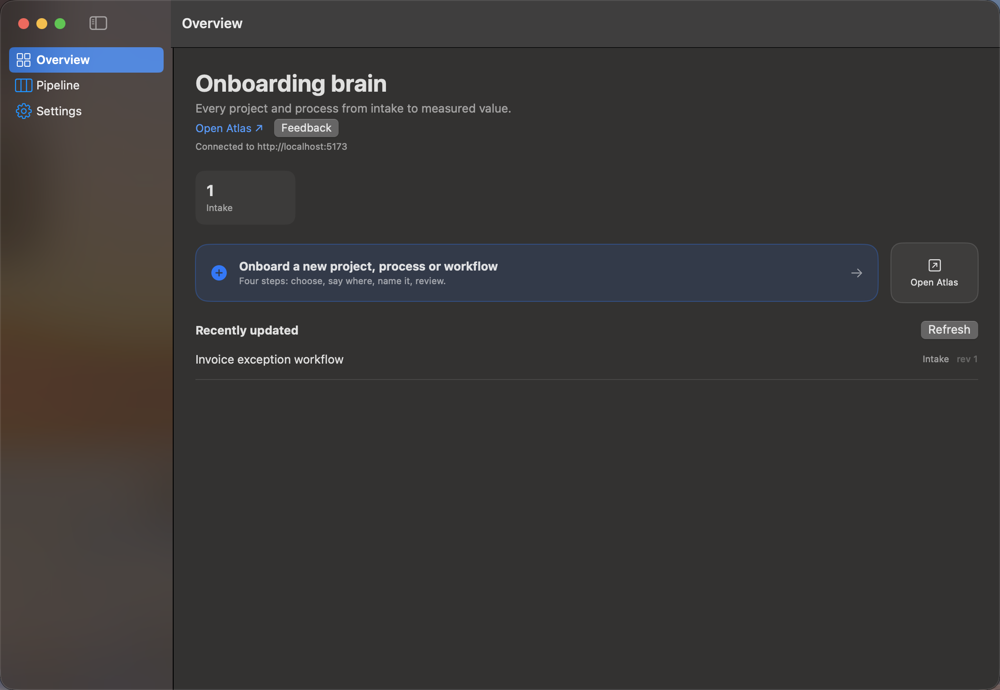
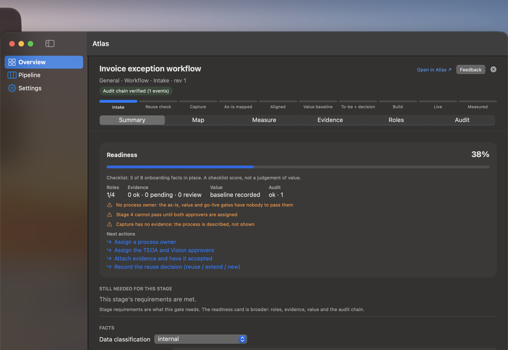
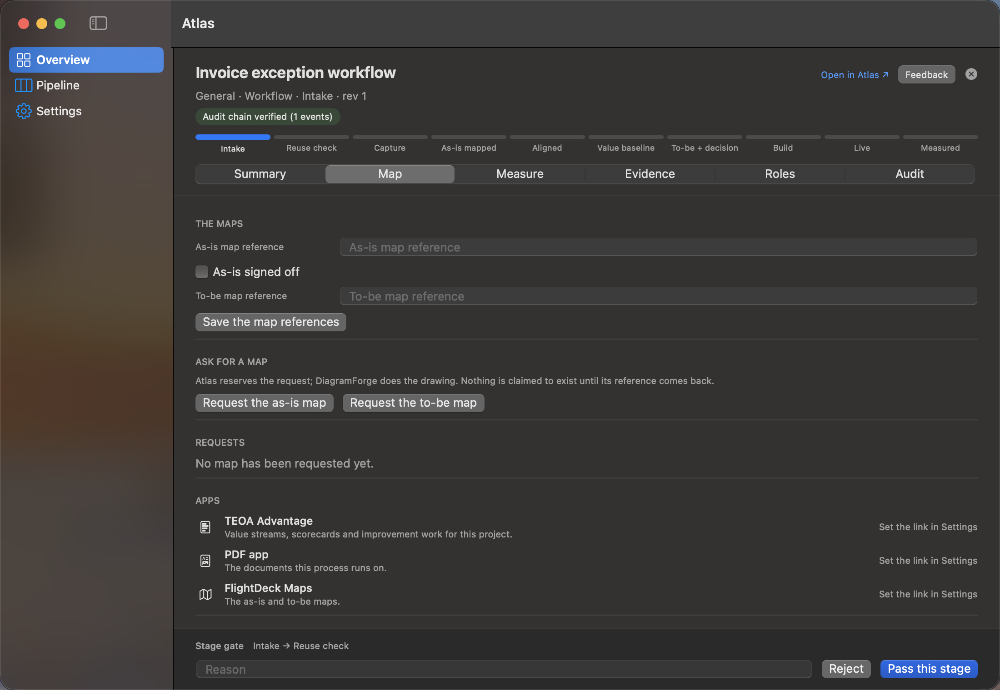
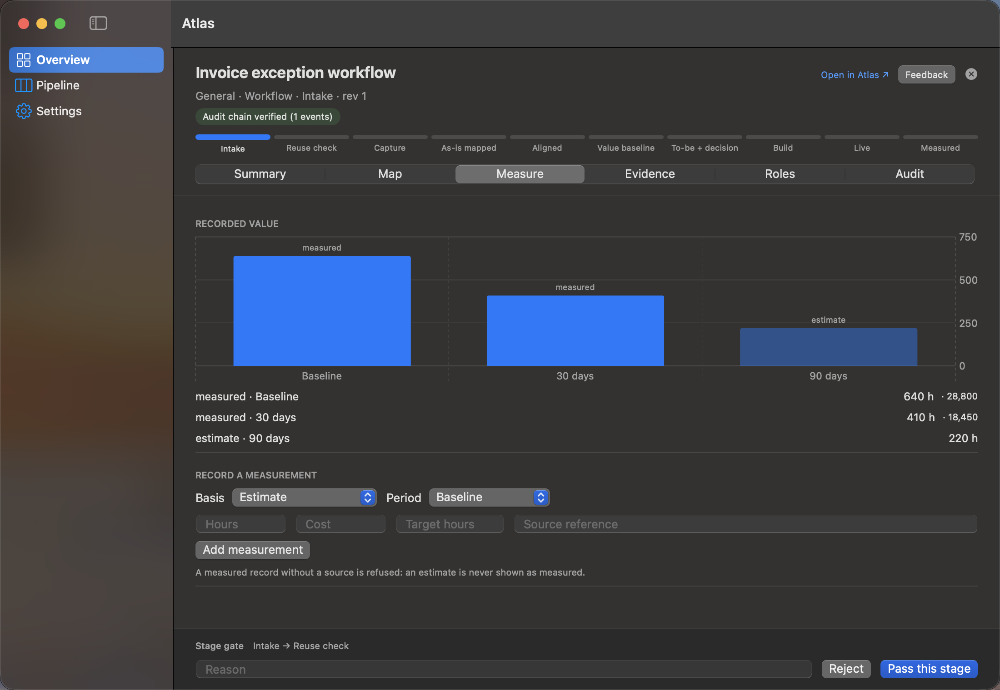

# Atlas for macOS — what the app is

Atlas is the front door for new work in FlightDeck OS. A project, a process or a
workflow is onboarded once in Atlas, and Atlas then keeps its brain: who asked,
why, what the current process looks like, what it is worth, who answers for it,
and where it stands. Atlas does not draw the maps, build the app or run the work —
it hands those to DiagramForge, Studio and the Companion, and it says plainly
when a hand-off is only reserved.

This is the desktop client. It speaks exactly the same API as the Atlas web lane,
so the two cannot disagree about a stage, a gate or a value record.

## Who it is for

| Person | What they do here |
|---|---|
| Requester / business owner | starts the intake, records the problem, attaches evidence |
| Process owner | signs off the as-is, the to-be, the value and go-live |
| Builder / CoE | triages, runs the reuse check, requests maps, sends work on |
| Workspace admin | creates projects in their workspace and assigns the roles |
| Super Admin | any workspace, any gate, the three app links, feedback and updates |

## The three verbs

**Create.** One wizard, four steps: *what* (a project, a process or a workflow,
as three illustrated cards), *where* (workspace and owner), *details* (name and
problem), *review*. It opens the intake and assigns the owner in the same action.

**Map.** The Map tab holds the as-is and to-be references and their sign-off, and
can **request** either map: Atlas reserves the hand-off for DiagramForge with an
idempotency key and shows the request as `reserved`. Nothing is claimed to exist
until the map reference comes back.

**Measure.** The Measure tab charts hours per period — baseline, 30 days, 90 days
— with `measured` and `estimate` told apart by colour and by label, the records
underneath, and a form that also takes a target. A measured record without a
source is refused by the server; an estimate is never shown as measured.

## The journey

1. **Overview** — the portfolio, the stage counts, and the front door.
2. **Wizard** — choose, where, details, review.
3. **Workspace** — the project opens in the window, not a sheet.
4. **Summary** — readiness, the stage's requirements, the facts, the reuse check.
5. **Map** — references, sign-off, map requests.
6. **Measure** — the chart, the records, a new measurement.
7. **Evidence** — what proves the process, with a hash and a classification.
8. **Roles** — owner, process owner, TEOA and Vision approvers.
9. **Gate** — pinned at the bottom: reason, Reject, Pass.
10. **Audit** — the hash-chained timeline.
11. **Atlas** — *Open in Atlas* lands on the same project inside the full lane.

## Screens

### Overview

Stage counts, the front door (*Onboard a new project, process or workflow*, or
⌘N), the recently updated projects, **Open Atlas** and **Feedback**.

### Workspace — Summary

The header says where it stands (workspace · kind · stage · revision, chain
badge). The rail shows all ten stages. The readiness card scores the onboarding
facts — here 3 of 8 — and lists what is missing as actions that open the tab that
does them. The gate is pinned below every tab.

### Workspace — Map

The map references and sign-off, the two request buttons, the request list, and
the three app links this client adds (TEOA Advantage, PDF, Maps).

### Workspace — Measure

640 h baseline → 410 h at 30 days → 220 h estimated at 90, measured and estimate
visibly different, and the form that records the next measurement.

## What it keeps, and what it refuses

- **Keeps:** the stage, the audit chain (hash-chained, append-only), the facts,
  the reuse decision, evidence metadata, value records with their basis, roles,
  hand-off reservations, feedback and the update check.
- **Refuses:** a gate without the role *and* the assignment; a measured value
  without a source; a fact a hand-off owns; a restricted classification; an
  unknown version in any contract; a "you are up to date" when the check was
  refused.
- **Never:** uploads the evidence file (it hashes it locally and records the
  metadata), draws a map, writes to FlightDeck OS, or guesses an app URL.

## How it is built

- `atlas/macos/Atlas` — a Swift package: `AtlasDomain` (models generated from
  `schema/*.schema.json`, the stage ladder, the analysis, the client) and `Atlas`
  (the app). `./build.sh` installs `~/Applications/Atlas.app`.
- The contract models are generated (`scripts/gen-swift.mjs`) from the same JSON
  Schemas the web tests use, and `swift test` decodes the same fixtures — so the
  two surfaces cannot drift.
- `ATLAS_SELFTEST=1` runs the whole onboarding through the app's own client
  against a live Atlas and exits non-zero if any step fails.

## Limits, stated rather than hidden

- No screen capture, on-device transcription or offline sync yet.
- A map request is reserved, never sent: the DiagramForge transport does not
  exist on this side.
- The three app links need their URLs set in Settings; no id or path is guessed.
- There is no KPI or process-mining model beyond value records.
- The pipeline cards do not show readiness; the list API carries name, stage and
  revision only.
- The wizard is for new work; it cannot reopen an existing project.
